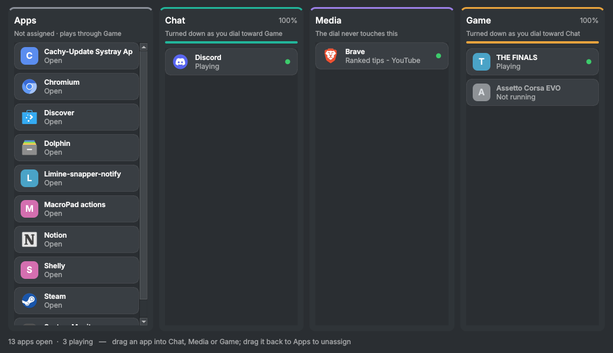

# nova-chatmix

**The ChatMix dial on your SteelSeries Arctis Nova Pro Wired, working on Linux, plus a little window to choose which apps count as Game, Chat or Media.**

[](https://aur.archlinux.org/packages/nova-chatmix)
[](https://aur.archlinux.org/packages/nova-chatmix)
[](https://github.com/Probler-Yt/nova-chatmix/releases)
[](https://github.com/Probler-Yt/nova-chatmix/actions/workflows/ci.yml)
[](LICENSE)



On older Arctis headsets ChatMix was done in hardware. On the Nova Pro, SteelSeries moved it into their Windows-only Sonar software, so on Linux the dial on the GameDAC does nothing. nova-chatmix brings it back:

- **The dial works again.** Turn it to balance game audio against voice chat, like on Windows. Press it to flip back to normal volume.
- **Game, Chat and Media outputs** on the DAC. Media (music, videos) is never turned down by the dial.
- **Drag-and-drop app routing.** Open *ChatMix*, drag Discord into Chat and your browser into Media. They go there automatically every time they make sound from then on, with the window closed. Your apps are grouped the way KDE System Monitor shows them, and Steam games appear under their real names (no Proton or anti-cheat clutter).
- **No GUI needed to run.** A small systemd user service does the work. It survives unplugging the DAC and PipeWire restarts, and hands the dial back to normal volume when it stops.
- **Lightweight.** The service is a single Python file that needs nothing beyond the standard library and `pactl`. The window uses Qt (PySide6), so it fits right in on KDE.

## Install

### Arch Linux / CachyOS / EndeavourOS / Manjaro (AUR)

```sh
yay -S nova-chatmix        # or: paru -S nova-chatmix
```

Then open **ChatMix** from your app menu and click **Turn it on**, or run `systemctl --user enable --now nova-chatmix`. Unplug and replug the GameDAC once so the new permissions apply.

### Other distros

Install Python 3, `pactl` (from `pulseaudio-utils` / `libpulse`) and PySide6 (`python3-pyside6`), then:

```sh
git clone https://github.com/Probler-Yt/nova-chatmix
cd nova-chatmix
./install.sh
```

This installs for your user only. The only part that needs `sudo` is a udev rule that lets you talk to the DAC without root.

> **Only one app can drive the dial.** If you use Arctis Sound Manager, Linux Arctis Manager or similar, stop them first. `install.sh` offers to do it for you.

## Using it

1. Everything plays through **Game** by default.
2. Open **ChatMix**. Your open apps are listed under **Apps**. Drag one into **Chat**, **Media** or **Game** to assign it, and drag it back to **Apps** to unassign it. A green dot means the app is making sound right now.
3. Turn the dial on the GameDAC: one way turns Chat down, the other turns Game down. Press the dial to switch between ChatMix and plain volume.

You can also pick the outputs by hand: `Game`, `Chat` and `Media` show up as normal output devices in your sound settings and in apps like Discord.

## Supported hardware

| Device | USB ID | Status |
| --- | --- | --- |
| Arctis Nova Pro Wired (GameDAC Gen 2) | `1038:12cb` | ✅ Tested |
| Arctis Nova Pro Wired, Xbox edition | `1038:12cd` | Should work (same DAC) |
| Arctis Nova Pro Wired V2 | `1038:12fa` | Should work (same protocol), untested |
| Arctis Nova Pro **Wireless** | `1038:12e0` | ❌ Not yet. See [SteelVoiceMix](https://github.com/Ibrahim-Aldhaheri/SteelVoiceMix) or [nova-chatmix-linux](https://github.com/Dymstro/nova-chatmix-linux) |

It's built for PipeWire (`pipewire-pulse`), which is the default on current distros.

## How it works

The Nova Pro's GameDAC doesn't mix anything itself. It reports where the dial is over USB HID and leaves the mixing to software. nova-chatmix:

1. Creates three virtual PipeWire outputs (`Game`, `Chat`, `Media`), each looped into the DAC.
2. Puts the dial into ChatMix mode by sending a 16-byte output report (`06 49 01`) to HID interface 4.
3. Reads the DAC's dial reports (`07 45 <game%> <chat%>`) and sets the volume of the Game and Chat loopbacks to match.
4. Watches PipeWire for new audio streams and moves each one to the output its app is assigned to. Apps are identified by the systemd unit they were launched in, which is what KDE System Monitor uses. Steam games are identified by the Steam app ID in their environment, which folds Proton, the Steam runtime and anti-cheat helpers into the game.

Assignments live in `~/.config/nova-chatmix/rules.json`.

## Troubleshooting

| | |
| --- | --- |
| Logs | `journalctl --user -u nova-chatmix -f` |
| What the window can see | `nova-chatmix-gui --debug` (please include this in bug reports) |
| Raw dial data | `systemctl --user stop nova-chatmix && nova-chatmix --listen` |
| Dial does nothing | Unplug and replug the DAC; make sure no other Arctis app is running |
| Restart | `systemctl --user restart nova-chatmix` |

## Uninstall

- **AUR:** `systemctl --user disable --now nova-chatmix`, then `sudo pacman -Rns nova-chatmix`
- **install.sh:** `./install.sh --uninstall` (add `--purge` to also forget your app assignments)

## Development

```sh
make test   # simulated GameDAC, PipeWire and KDE session; no hardware needed
```

The tests drive the real service and window against a fake DAC (a socket), a fake `pactl`, and a fake `/proc` modelled on a KDE desktop running a Proton game. They run twice, the second time with pactl's JSON output deliberately broken.

## Credits

Figuring out the GameDAC's protocol was made much easier by the people who reverse-engineered it first: [Linux Arctis Manager](https://github.com/elegos/Linux-Arctis-Manager), [Arctis Sound Manager](https://aur.archlinux.org/packages/arctis-sound-manager), [nova-chatmix-linux](https://github.com/Dymstro/nova-chatmix-linux), [SteelVoiceMix](https://github.com/Ibrahim-Aldhaheri/SteelVoiceMix) and [HeadsetControl](https://github.com/Sapd/HeadsetControl).

Not affiliated with or endorsed by SteelSeries. SteelSeries, Arctis, ChatMix and Sonar are their trademarks.

## License

[MIT](LICENSE) © Mohamed Mahjoub (Probler)
